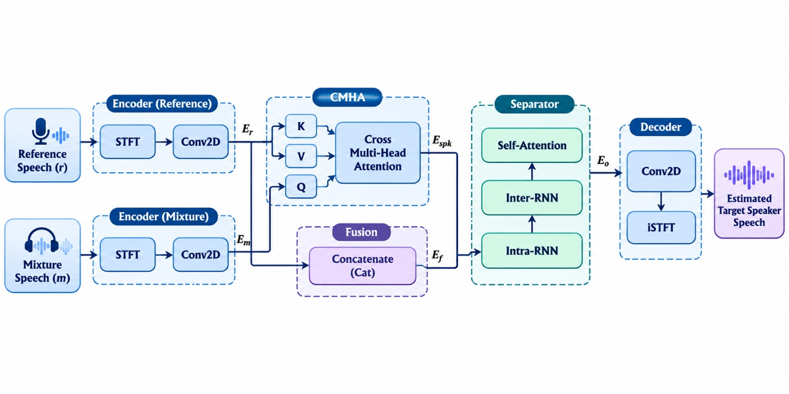

# USEF-TSE: Target Speaker Extraction Web Application

A full-stack web application for demonstrating **Universal Speaker Embedding Free Target Speaker Extraction (USEF-TSE)** using a pretrained USEF-TFGridNet model.

This project integrates the original research implementation with a web-based interface. Users can upload a multi-speaker audio mixture and a short reference recording of the target speaker, extract the target speaker's speech, listen to the result, and download the extracted audio.

**Based on the research paper:** *USEF-TSE: Universal Speaker Embedding Free Target Speaker Extraction* by Z. Bang et al. ([arXiv:2409.02615](https://arxiv.org/abs/2409.02615)).

---

## 🚀 Key Features

- **Deep Learning-Based Extraction:** Uses a pretrained USEF-TFGridNet model for target speaker extraction.
- **Two Audio Inputs:** Upload a mixed audio recording and a reference recording of the target speaker.
- **Interactive Audio Playback:** Listen to the input recordings using integrated audio players and waveform visualizations.
- **Target Speaker Extraction:** Process uploaded audio through the USEF-TSE inference pipeline.
- **Extraction Results:** Listen to the estimated target speech and download the output as a WAV file.
- **Demo Samples:** Load built-in sample recordings to try the application without preparing your own audio files.
- **Full-Stack Architecture:** React frontend integrated with a FastAPI and PyTorch backend.

---

## 🖼️ System Architecture

The following diagram illustrates the overall architecture and workflow of the application.



### Application Workflow

1. The user uploads a mixed audio recording and a target speaker reference.
2. The React frontend sends both audio inputs to the FastAPI backend.
3. The backend performs the required audio preprocessing.
4. The USEF-TFGridNet model processes the mixture and reference features to estimate the target speaker's speech.
5. The backend returns the extracted audio to the frontend.
6. The user can listen to and download the extracted WAV file.

---

## 🧠 How USEF-TFGridNet Works

The application uses USEF-TFGridNet as its target speaker extraction model.

At a high level, the model follows these stages:

1. **Audio Encoding:** The mixture and reference audio are transformed into time-frequency representations using Short-Time Fourier Transform (STFT)-based processing and encoded into feature representations.
2. **Feature Fusion:** The mixture and reference features are combined using reference-conditioned cross-attention.
3. **TF-GridNet Separator:** The fused features are processed by the TF-GridNet separator.
4. **Audio Reconstruction:** The estimated target speech representation is reconstructed into a time-domain audio signal using inverse STFT (iSTFT).

### TF-GridNet Separator Components

The TF-GridNet separator includes the following processing modules:

| Component | Function |
|---|---|
| Intra-frame full-band module | Uses a bidirectional LSTM to model frequency-related information within each frame |
| Inter-frame sub-band temporal module | Uses a bidirectional LSTM to model temporal relationships across frames |
| Cross-frame self-attention | Captures relationships between different time frames using attention |

The intra-frame and inter-frame modules are recurrent processing stages, while cross-frame self-attention provides additional attention-based temporal modelling.

**Note:** Reference-conditioned cross-attention in the feature fusion stage and cross-frame self-attention inside the separator are two distinct attention operations.

---

## 🛠️ Technology Stack

| Component | Technology |
|---|---|
| Frontend | React, Vite |
| Styling | Tailwind CSS |
| Backend | Python, FastAPI |
| Deep Learning | PyTorch |
| Extraction Model | USEF-TFGridNet |
| Audio Processing | STFT / iSTFT |
| Communication | REST API |

---

## 📁 Repository Structure

```text
USEF-TSE-Target-Speaker-Extraction/
│
├── original-USEF-TSE/           # Original research source code
│   ├── config/                  # Model configurations
│   ├── models/                  # Model architectures and layers
│   ├── dataset/                 # Dataset loading utilities
│   ├── trainer/                 # Training routines
│   ├── utils/                   # Supporting utilities
│   └── LICENSE                  # Original research licence
│
├── backend/
│   ├── app.py                   # FastAPI application and API endpoints
│   ├── inference.py             # Model inference pipeline
│   ├── create_samples.py        # Demo sample generation
│   ├── requirements.txt         # Python dependencies
│   ├── checkpoints/             # Location for pretrained model weights
│   ├── samples/                 # Built-in demo audio samples
│   └── temp/                    # Temporary audio files
│
├── frontend/
│   ├── public/                  # Static assets
│   ├── src/
│   │   ├── components/          # React UI components
│   │   ├── App.jsx              # Main application workflow
│   │   └── index.css            # Application styles
│   └── package.json             # Frontend dependencies
│
├── docs/
│   └── architecture.jpeg        # System architecture diagram
│
├── run_app.py                   # Application launcher
└── README.md
```

---

## 💻 Installation and Setup

### 1. Prerequisites

Install the following:

- Python 3.10 or later
- Node.js 18 or later
- npm
- Git

### 2. Clone the Repository

```bash
git clone https://github.com/YOUR-USERNAME/USEF-TSE-Target-Speaker-Extraction.git
cd USEF-TSE-Target-Speaker-Extraction
```

Replace `YOUR-USERNAME` with the GitHub username that hosts this repository.

### 3. Install Dependencies

Create a Python virtual environment:

```bash
python -m venv .venv
```

Activate it on Windows:

```powershell
.venv\Scripts\activate
```

On Linux or macOS:

```bash
source .venv/bin/activate
```

Install backend dependencies:

```bash
pip install -r backend/requirements.txt
```

Install frontend dependencies:

```bash
cd frontend
npm install
cd ..
```

These installation steps are required during the initial setup or when dependencies change.

---

## 📦 Pretrained Model Checkpoint Setup

The pretrained model checkpoint is intentionally not included in this GitHub repository because of its large file size.

The application requires the USEF-TFGridNet checkpoint to perform target speaker extraction.

**Expected checkpoint location:**

```text
backend/
└── checkpoints/
    └── usef_tfgridnet_wsj02mix.pth.tar
```

Before running the application:

1. Obtain the pretrained checkpoint from an authorized source.
2. Refer to [`backend/checkpoints/README.md`](backend/checkpoints/README.md) for checkpoint setup instructions.
3. Place the downloaded checkpoint inside `backend/checkpoints/`.
4. Ensure the filename is exactly:

```text
usef_tfgridnet_wsj02mix.pth.tar
```

**Note:** The application cannot perform model inference without the required checkpoint.

---

## ▶️ Running the Application

After installing the dependencies and placing the checkpoint in the correct location, run this single command from the project root:

```bash
python run_app.py
```

The launcher starts both application services:

- **FastAPI Backend:** http://127.0.0.1:8000
- **API Documentation:** http://127.0.0.1:8000/docs
- **Frontend:** http://localhost:5173

Open the frontend in your browser:

[http://localhost:5173](http://localhost:5173)

---

## 🧪 Demonstration Workflow

1. Open the web application in your browser.
2. Check the backend/model status indicator.
3. Click **Load Demo Samples** to load the available example recordings.
4. Alternatively, upload your own mixed audio and target reference audio.
5. Listen to both input recordings.
6. Click **Extract Target Speaker**.
7. Wait for the extraction process to finish.
8. Listen to the extracted target speech in the result section.
9. Click **Download WAV** to save the output.

Extraction time depends on the input audio duration and available hardware. The quality of the extracted speech may vary depending on the audio and reference recording.

---

## 🔌 API Endpoints

The backend exposes REST API endpoints through FastAPI.

| Endpoint | Purpose |
|---|---|
| `/api/status` | Check application/model status |
| `/api/extract` | Submit audio for target speaker extraction |
| `/api/samples` | Access built-in demo samples |

Interactive API documentation is available at:

[http://127.0.0.1:8000/docs](http://127.0.0.1:8000/docs)

---

## ⚠️ Limitations and Notes

- The pretrained checkpoint must be obtained separately.
- Extraction performance depends on the available CPU/GPU hardware.
- Output quality depends on the mixture audio, reference recording, and speaker overlap.
- The application is intended as an academic research demonstration and not as a production-grade speech processing service.

---

## 📚 Original Research and Attribution

This project is based on the research work **USEF-TSE: Universal Speaker Embedding Free Target Speaker Extraction**.

- **Original repository:** [ZBang/USEF-TSE](https://github.com/ZBang/USEF-TSE)
- **Research paper:** [arXiv:2409.02615](https://arxiv.org/abs/2409.02615)
- **Original code licence:** Creative Commons Attribution-NonCommercial 4.0 International (CC BY-NC 4.0)
- **Licence details:** [Creative Commons CC BY-NC 4.0](https://creativecommons.org/licenses/by-nc/4.0/)

The original USEF-TSE source code is retained in `original-USEF-TSE/` with its original LICENSE file.

This project adds a web application interface and integration for demonstrating target speaker extraction. The additional application components are separate contributions.

The original research code is attributed to its respective authors. This project is an independent academic implementation and is not an official release of the original authors.